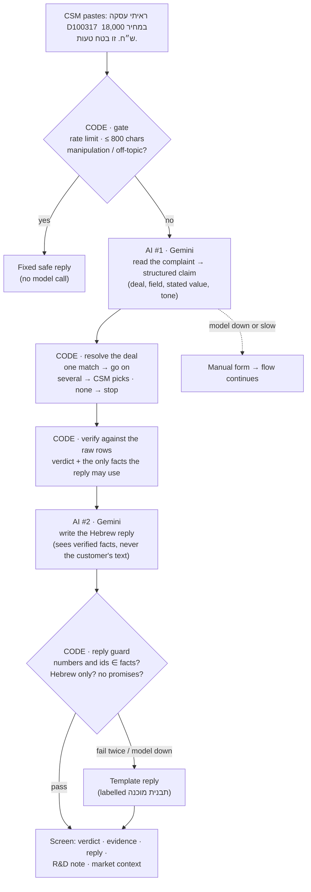
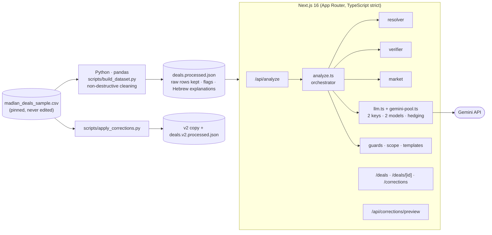

<div align="center">

# מדלן-בדק · Madlan Dispute Workbench

**When a customer says _"this number is wrong"_, a CSM gets a verified answer, the evidence, and a safe reply in under two minutes.**

A Hebrew, right-to-left tool where an LLM reads and phrases, and deterministic code decides what is true.


**Live demo:** _add the Vercel URL here after deploy_ ·
[Deploy your own](https://vercel.com/new/clone?repository-url=https%3A%2F%2Fgithub.com%2Fbar6132%2Fmadlan-workbench&env=GEMINI_API_KEY,GEMINI_V2_API_KEY&envDescription=Google%20AI%20Studio%20API%20keys%20(the%20second%20is%20optional)&project-name=madlan-workbench)

</div>

---

## The 30-second version

Madlan's R&D Operations challenge hands you a deliberately dirty CSV of Israeli property deals and asks for something useful, built with an LLM, live, in Hebrew, that **only says what the data supports**.

The role sits between R&D, Customer Success and customers, so the product is the tool a CSM opens at the worst moment: a customer is upset about a number the site showed. Paste their message and the app:

1. **Understands** it (LLM): which deal, which number, how upset.
2. **Checks** it against the file (plain code): no guessing, no LLM math.
3. **Shows the proof**: the original rows next to the cleaned values.
4. **Drafts a reply** (LLM) that may only contain verified facts, then **verifies the draft** (code) before the CSM sees it.
5. **Hands over to R&D** with a ready note when the data cannot settle the question.

> The model never decides what is true. It reads the message in and words the answer out; code decides everything in between and checks the model on the way out.

## What's in the box

| Screen | What it's for |
|---|---|
| **בדיקת תלונה** `/` | Paste a complaint → verdict, evidence, guarded reply, R&D note, market context. |
| **מאגר עסקאות** `/deals` | Search and filter all 520 deals (by id however typed, street, city, status, flag, source, price). Every deal has its own page with the raw rows, flags and explanations. |
| **הצעת תיקון** (card on every check and deal page) | Propose a data fix with a before/after preview. Nothing is saved; safe on a public URL. |
| **תיקונים** `/corrections` | What approved corrections changed in a **v2 copy** of the data, while the original CSV stays pinned. |
| `GET /api/deals` | The same query as JSON, with cache headers. |

Light and dark themes, phone-width layout, and a debug panel with a failure simulator (off in production).

## How a complaint flows



For the example above: the model reads `D100317` / price / 18,000; code finds one deal whose price (18,000) is under the 250,000 limit and whose price per m² (0) contradicts price ÷ size (136); the verdict is _"the file value is inconsistent"_, and the reply quotes only those numbers.

### The five verdicts

| Verdict | Meaning | CSM action |
|---|---|---|
| **הנתון בקובץ אינו עקבי** | The file contradicts itself (price vs price per m², new-build label vs building year…) | Send the reply; the customer is right about what the file says |
| **סתירה בין מקורות** | Two reports for one deal disagree (e.g. D100124: ₪5,727,000 vs ₪5,429,440) | Send the reply + R&D note |
| **הנתון בקובץ עקבי** | No contradiction found. It never judges whether a price is "fair" | Send the reply |
| **לא ניתן לקבוע** | The file lacks it (balcony area, house number…) | Send the reply + R&D note |
| **העסקה לא נמצאה** | No such deal | Ask for an id or exact address |

## Built to be trusted

**It only says what the data supports, and shows its basis.**
- Every number or deal id in a reply must be in the verified facts, or the draft is rejected and a template is used. Also rejected: English or foreign-script text (a real model run once put an Arabic letter inside a Hebrew word), promises, blame, "5.7 million"-style number words.
- The evidence table shows raw rows beside cleaned values, with _computed_ vs _assumed_ labels.
- When the data is missing, thin (fewer than 5 deals → no statistic) or contradictory, the app says so in plain Hebrew.
- It never auto-picks between several matching deals.

**It resists being steered.**
- The customer's text reaches only the extraction step, whose output is schema-validated. The reply step never sees it (prompt-injection defense by construction, tested with a canary string).
- "I'm the admin", "delete all", "what's your API key", off-topic questions: stopped by a keyword list before any model call, backed by the model's own `intent` label. The CSM gets the fixed reply _"לא מצאתי את המידע שחיפשת. לפרטים נוספים יש לפנות לשירות הלקוחות."_ Real customers using similar words ("אני מנהל נכסים", "אני בעלים של הדירה") are not refused.
- There is no SQL: the data is a JSON file in memory. SQL-looking text is inert everywhere (tested).
- Ids are understood however typed: `D100317`, `d100317`, `D 100 317`, glued to Hebrew, or bare `100317` (only if it is exactly an existing deal and not an amount; the CSM is told how it was read).
- Several complaints in one message: the CSM picks a deal; each deal keeps its own complaint type; the others are named as not yet checked.

**It fails gracefully.**

| What breaks | What the CSM sees |
|---|---|
| Extraction model down / slow / invalid | A clear message and a manual form; verification and the rest keep working |
| Reply model down / slow / draft rejected | A template reply labelled _תבנית מוכנה_ |
| Free-tier quota (429) or a slow model | Automatic failover across two API keys and two models (below) |
| Unexpected server error | Short Hebrew message + trace id. Never a stack trace |

**Model routing.** `lib/gemini-pool.ts` tries `gemini-3.1-flash-lite` on both keys (alternating start for load spreading), then the fallback `gemini-3.5-flash-lite` on both. A 429 puts that key+model on a 60 s cooldown. If an attempt is silent for 3.5 s, the next one starts **in parallel** and the first answer wins (the free tier answers in ~1.5 s but sometimes spikes to 6–27 s); total budget 15 s.

**It is debuggable.** Every request has a `trace_id` returned to the client and written as one structured JSON log line (stage timings, provider, verdict, guard decisions; never the customer's text, tested). The R&D note carries it.

## Propose a correction, without breaking anything

After a check, the CSM can open **הצעת תיקון נתונים**: the card shows the deal, what the system found, and the original rows with the cell to be corrected highlighted. They enter the correct value, why, and where the information came from (all required). The app shows a before/after preview (status, price, price per m², whether the deal enters market statistics, the verdict, the market median) and produces a copyable request for R&D plus the exact CSV change.

- **Suggestions are derived, never guessed.** The only suggested value is price ÷ size, labelled as resting on an assumption. For an implausible price (D100317) there is no suggestion, because the true price is not in the file.
- **Approved corrections go to a copy.** `python scripts/apply_corrections.py` copies the original CSV to `data/madlan_deals_sample_v2.csv`, changes only approved cells (aborting if the cell doesn't hold the expected old value, if the row belongs to another deal, or if asked to overwrite the original) and rebuilds the v2 dataset.
- **The preview cannot drift from the pipeline.** It is a TypeScript port of the price-dependent rules; `tests/corrections-parity.test.ts` runs the real Python pipeline on corrected CSVs and requires identical results, plus a no-change run over every deal.
- A test fails if the original CSV ever changes. The two entries committed are demos derived from the same rows, not approvals by a person.

## The data, and what it can't tell us

Measured on the file (the app's tests re-verify these):

| | |
|---|---|
| Rows → unique deals | 530 → 520 |
| City spellings → real cities | 29 → 18 |
| Rows where price per m² contradicts price ÷ size | 29 |
| Exact duplicate / conflicting duplicate deals | 6 / 4 (two conflicts are owner vs broker with **no** Tax Authority row) |
| Prices excluded from statistics | 2 (`D100251` = 0, `D100317` = 18,000) |
| "חדש מקבלן" deals built before 2015 | 83 of 100 |
| City+neighborhood groups with fewer than 5 deals | 74 of 124 |
| Date formats | ISO, `DD/MM/YYYY`, `DD.MM.YYYY`, month-name only |

**Not in the file at all:** house numbers, balcony/garden area, urban-renewal (TAMA 38) status, and, crucially, **what the website actually showed the customer**. The app says so instead of guessing.

For all four conflicting deals, the row whose price ÷ size equals the file's price per m² is the original. That is stronger evidence than any assumed source ranking, so it decides the primary row; "Tax Authority > broker > owner" is only a last-resort fallback and the UI says so.

## Architecture



**Why Python for cleaning and TypeScript for the app?** One source of truth for the rules. The app only reads the file the pipeline produced; a test fails if the committed JSON is stale; and the correction preview is tested against the real pipeline.

**Stack:** Next.js 16 · React 19 · TypeScript (strict) · Tailwind 4 · Zod 4 · Vitest · Python 3 + pandas + pytest · `@google/genai` · Vercel.

<details>
<summary><b>Project layout</b></summary>

```
app/                    pages and API routes (analyze, deals, corrections/preview)
components/             UI (forms, results, correction card, theme toggle, nav)
lib/
  analyze.ts            orchestrator: gate → extract → resolve → verify → reply → guard
  claim.ts · reply.ts   the two LLM steps (prompts + schemas)
  llm.ts · gemini-pool.ts   transport, failover, hedging, cooldowns
  verifier.ts           deterministic verdicts per complaint type
  resolver.ts           id/address → deal (never auto-picks)
  guards.ts · scope.ts · templates.ts   reply guard, manipulation filter, fallbacks
  market.ts · explorer.ts  context statistics, search/filter/sort/paging
  correction-core.ts · corrections.ts   proposal rules, preview, approved list
scripts/                build_dataset.py · apply_corrections.py · eval-live.mjs · pytest
data/                   original CSV · processed JSON · v2 copy · approved corrections
tests/                  Vitest (model mocked)
docs/                   design · plan · CSM guide · AI work log · demo script
```
</details>

## Tests and evaluation

| Suite | What it proves | Run |
|---|---|---|
| **Vitest** (178) | Verifier per verdict, resolver, guards, orchestrator, API, edge cases (id forms, SQL text, manipulation, several complaints), failover and hedging with fake timers, correction rules | `npm test` |
| **pytest** (21) | The data rules on the real CSV; corrections apply only to the copy and refuse stale or wrong-row edits | `python -m pytest scripts/tests` |
| **Parity** | The TypeScript correction preview equals the real Python pipeline on corrected CSVs | in `npm test` |
| **Live evaluation** (21 cases) | The real model on hostile and sloppy messages; asserts invariants ("the reply never contains an injected number") | `npm run eval:live` |

The mocked tests prove _our_ code's guarantees; the live evaluation checks the model's behaviour. Both exist because the first real-model run found problems the mocks could never show (see the AI log).

## Run locally

```bash
npm install
pip install -r scripts/requirements.txt
cp .env.example .env.local        # add GEMINI_API_KEY (and optionally GEMINI_V2_API_KEY)
npm run dev                       # http://localhost:3000
npm test
python -m pytest scripts/tests
```

Without a key the app still works: understanding falls back to a manual form and replies are templates. `python scripts/build_dataset.py` is only needed if you change a cleaning rule. For the failure simulator, add `NEXT_PUBLIC_ENABLE_DEBUG=1` to `.env.local` and open `/?debug=1`.

## Deploy to Vercel

1. Import the repo (framework: Next.js; no build settings to change).
2. Set environment variables:

| Variable | Value |
|---|---|
| `GEMINI_API_KEY` | Google AI Studio key (required for AI features) |
| `GEMINI_V2_API_KEY` | Second key, for load spreading and failover (optional) |
| `GEMINI_MODELS` | Optional comma-separated override of the model priority list |
| `NEXT_PUBLIC_ENABLE_DEBUG` | **Leave unset in production.** `?debug=1` then does nothing |

3. Deploy. No Python runs in production: the app reads the committed `data/*.json`, and `next.config.ts` traces those files into every route that reads them.

## Decisions and assumptions (not given by Madlan)

- The "number the customer saw" is the raw CSV value; what a live site displayed is unknowable from here.
- Excluded from statistics: price missing/0 or under ₪250,000. Price per m² tolerance 1%. Market window: 24 calendar months ending at the latest deal (2026-07). At least 5 deals for any statistic.
- Month-only dates (`Aug 2025`) are month-precise only. Missing values stay _unknown_, never "no".
- Timeline contradictions, new-build labels with old years, and price-per-m² outliers are **flagged, not excluded**: a wrong build year doesn't make the price wrong.
- No "is this price fair" verdict: too few comparables.

## What was cut, and why

A second LLM provider (the adapter takes a provider function, so it can be added), a database and auth (the data is a file; propose-only corrections avoid needing them), Python at runtime, and a CMS/admin area (it would not help a CSM answer an upset customer).

## Known limits

- The rate limiter (15 requests/min/IP) is in memory per serverless instance: best effort, resets on cold start.
- Free-tier Gemini content may be used by Google to improve its products. The CSV is non-personal sample data.
- The reply guard checks which numbers and ids appear, not what they are attached to; a draft could swap which figure belongs to which source and still pass. The CSM reads and edits the draft before sending.
- Corrections can propose price, size and price per m²; building year and condition are reported as inconsistent (and escalated) but have no correction form yet.
- Server log retention depends on the Vercel plan.

## Docs

[Design](docs/design.md) · [Implementation plan](docs/plan.md) · [CSM guide (Hebrew, one page)](docs/CSM_GUIDE.md) · [AI work log](docs/AI_WORK_LOG.md) · [Demo script](docs/DEMO_SCRIPT.md)

The **AI work log** is not decoration: it lists 20 real moments where an AI answer was wrong or incomplete and what caught it, from naive date parsing to a complaint type the taxonomy forgot.
